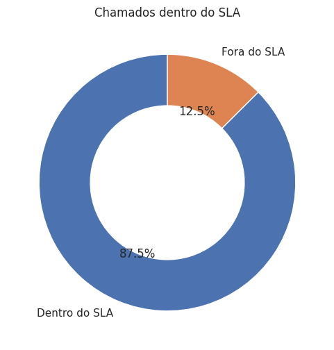
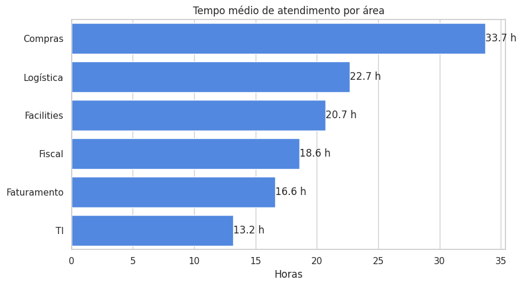
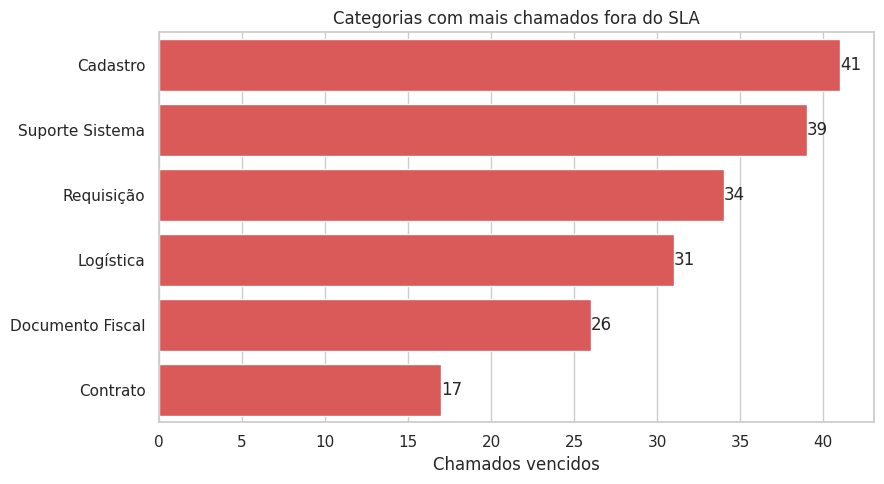

# SLA e Performance Operacional

Projeto de análise de SLA e performance operacional sobre uma base simulada de chamados internos, desenvolvido em Python no Databricks.

Analysis of SLA compliance and operational performance on a simulated base of internal requests, built with Python on Databricks.

## Objetivos

- Tratamento de dados com Pandas | Data wrangling with Pandas
- Visualização com Matplotlib e Seaborn | Visualization with Matplotlib and Seaborn
- Indicadores operacionais: demandas abertas e concluídas, SLA cumprido e vencido, tempo médio de atendimento | Operational KPIs: open and closed requests, SLA met and breached, average handling time

## Base de dados

Base sintética com 1.500 chamados, gerada com seed fixa (`numpy.random.default_rng(42)`), o que garante resultados reproduzíveis.

| Coluna | Descrição |
|---|---|
| id_chamado | Identificador do chamado |
| data_abertura | Data e hora de abertura |
| data_conclusao | Data e hora de conclusão (nula para chamados em andamento) |
| area | Fiscal, Faturamento, Logística, Compras, Facilities ou TI |
| categoria | Documento Fiscal, Cadastro, Requisição, Suporte Sistema, Logística ou Contrato |
| prioridade | Alta (24 h), Média (48 h) ou Baixa (72 h) |
| sla_horas | Prazo de SLA em horas |
| tempo_atendimento_horas | Tempo de atendimento em horas |
| status | Concluído ou Em andamento |
| sla_status | Cumprido, Vencido ou No prazo |

## Resultados

| Indicador | Valor |
|---|---|
| Demandas abertas | 116 |
| Demandas concluídas | 1.384 |
| SLA cumprido | 87,5% |
| SLA vencido | 12,5% |
| Tempo médio de atendimento (concluídos) | 20,2 h |

- Área com maior tempo médio: Compras (33,7 h)
- Categoria com mais chamados fora do SLA: Cadastro (41)

## Notebooks

| Notebook | Função |
|---|---|
| notebooks/01_geracao_base | Geração da base fictícia de chamados |
| notebooks/02_indicadores | Cálculo dos indicadores operacionais |
| notebooks/03_visualizacoes | Gráficos de SLA, tempo médio por área e atrasos por categoria |

Cada notebook é autocontido e recria a base com a mesma seed.

## Stack

Python, Pandas, NumPy, Matplotlib, Seaborn, Databricks

## Roadmap

- [x] Fase 1: base, indicadores e gráficos
- [ ] Fase 2: tabela Delta e dashboard no Databricks
- [ ] Fase 3: evolução mensal do SLA e análise por prioridade

## Autor

nevvesdev